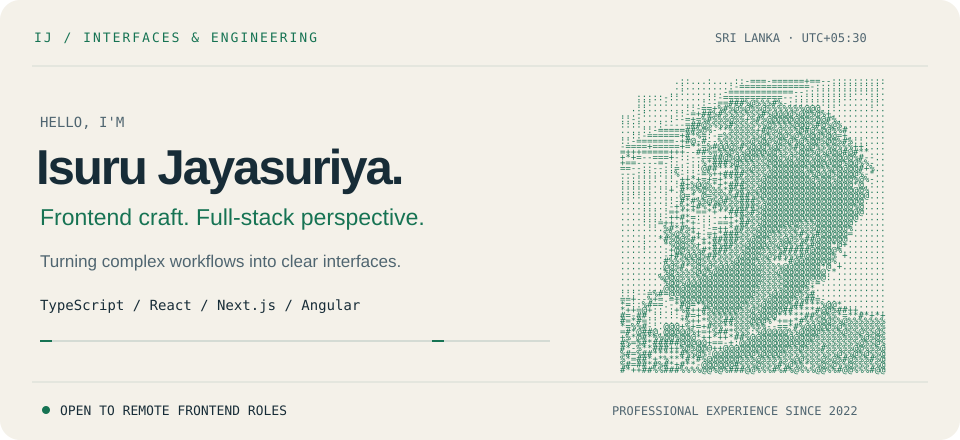
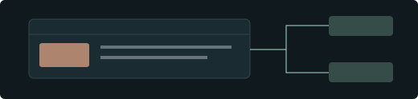

<picture>
  <source media="(max-width: 600px) and (prefers-color-scheme: dark)" srcset="./assets/header-mobile-dark.svg">
  <source media="(max-width: 600px)" srcset="./assets/header-mobile-light.svg">
  <source media="(prefers-color-scheme: dark)" srcset="./assets/header-dark.svg">
  
</picture>

## Frontend-focused Software Engineer

**TypeScript · React · Next.js · Angular**

Good interfaces make complex work feel simple.

I'm **Isuru**, a frontend-focused Software Engineer based in Sri Lanka, with **nearly five years of professional software engineering experience since January 2022**. I've built healthcare interfaces, public websites and business applications while completing my Software Engineering degree with **First Class Honours**.

**Frontend is my focus:** TypeScript, React, Next.js and Angular. My experience across backend development, Playwright automation and cloud delivery helps me follow a feature from the interface through to production.

I've worked with **international teams**, collaborating across frontend, backend, QA and delivery.

**Open to remote frontend opportunities with international teams.**

---

## A few things I've built

###  &nbsp;01 / Clinical workflows

Angular interfaces for screening, cardiovascular risk assessment and diabetes management. Reusable components, eligibility logic, interactive risk calculations and printable reports that support clinical workflows.

`Angular` · `TypeScript` · `.NET Core`

###  &nbsp;02 / A connected public website

Frontend development for a healthcare company's website, with Zoom, Zendesk and Google Analytics integrations. Worked across the interface and supporting AWS deployment services.

`React / Next.js` · `Chakra UI` · `Plasmic` · `AWS`

###  &nbsp;03 / Transport operations

Playwright automation followed by full-stack development on **Transpomate**, covering a platform for transport requests, approvals and vehicle allocation.

`TypeScript` · `Next.js` · `NestJS` · `MSSQL` · `Azure`

###  &nbsp;04 / Enterprise interfaces

Modular UI and backend integrations for tea auctioning and blending software connected to IFS and other ERP systems. Healthcare application re-skinning, UI fixes and API support work.

`UI development` · `API integrations` · `ERP`

## Frontend first. Comfortable across the stack.

| Focus | Toolkit |
| :--- | :--- |
| **Frontend** | TypeScript · JavaScript · React · Next.js · Angular · HTML · CSS |
| **Interfaces** | Responsive layouts · Reusable components · Chakra UI · Plasmic · UI redesigns |
| **Backend & data** | NestJS · C# · .NET Core · Microsoft SQL Server · API & ERP integrations |
| **Quality** | Playwright · Test automation · UI debugging · Application support |
| **Cloud & delivery** | Azure · Azure DevOps · AWS Amplify · Lambda · API Gateway · CI/CD |
| **Automation & foundations** | Python · YAML · Git · Java / Java SE |

## The experience behind the interfaces

**Inivos · January 2022–present**  
**Software Engineer**

Worked on internal products and collaborated with international teams. My work has spanned frontend development, backend integrations, test automation and deployment. Since July 2026, my current assignment focuses on DevOps engineering, including Python, YAML and CI/CD.

I bring experience collaborating across frontend, backend, QA and delivery responsibilities, with an understanding of how interface decisions connect to the rest of a system.

**BEng (Hons) Software Engineering · First Class Honours**  
Awarded by **University of Westminster, UK** · Studied at **IIT, Sri Lanka**  
September 2021–2026

**Additional learning**  
Java Application Development (Java SE) — University of Colombo School of Computing  
Foundations of Project Management — Google

**Languages:** English · Sinhala

---

  <strong>Building a product that needs a thoughtful frontend?</strong> 
  <a href="mailto:isurutjayasuriya@gmail.com">Let's talk about your team →</a>  
  Sri Lanka · UTC+05:30 · Open to international remote opportunities

